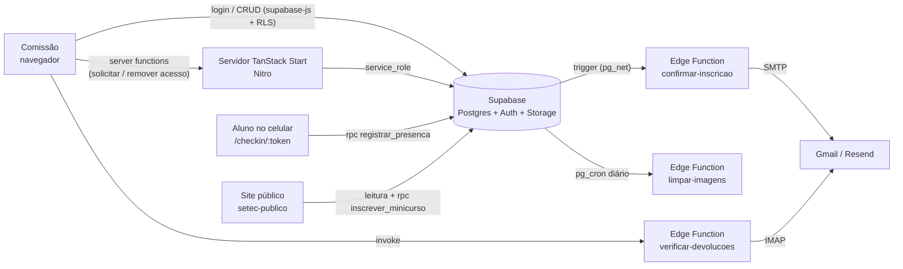

# SETEC — Painel Administrativo

[](https://github.com/mkrosz/setec-administrativo/actions/workflows/ci.yml)

Painel usado pela comissão organizadora da **Semana de Tecnologia (SETEC) da
FATEC Sorocaba** para cadastrar a programação, os apoiadores e a comissão,
gerenciar inscrições em minicursos e registrar a presença dos alunos nas
palestras por QR Code.

Tudo o que é salvo aqui aparece no site público do evento
([setec-publico](https://github.com/mkrosz/setec-publico)), que lê o mesmo
banco **Supabase**.

---

## Sumário

- [Objetivo e problema](#objetivo-e-problema)
- [Escopo](#escopo)
- [Requisitos](#requisitos)
- [Tecnologias](#tecnologias)
- [Arquitetura](#arquitetura)
- [Estrutura do projeto](#estrutura-do-projeto)
- [Pré-requisitos](#pré-requisitos)
- [Instalação](#instalação)
- [Configuração](#configuração)
- [Banco de dados](#banco-de-dados)
- [Edge Functions](#edge-functions)
- [Execução](#execução)
- [Testes e qualidade](#testes-e-qualidade)
- [Deploy](#deploy)
- [Processo de desenvolvimento](#processo-de-desenvolvimento)
- [Solução de problemas](#solução-de-problemas)
- [Segurança](#segurança)

---

## Objetivo e problema

A organização da SETEC dependia de planilhas, formulários avulsos e listas de
presença em papel. Os principais problemas eram:

- a programação divulgada ficava desatualizada quando horário, sala ou palestrante mudava;
- as inscrições nos minicursos não tinham controle de vagas nem de inscrição duplicada;
- a presença em papel era lenta de conferir e fácil de fraudar (alguém assinando por outro);
- não havia registro de quem alterou o quê, nem como voltar atrás depois de um erro;
- a cada nova edição, os dados do ano anterior precisavam ser apagados à mão.

O painel centraliza esse trabalho: a comissão edita os dados num só lugar, o
site público é atualizado na hora e as ações ficam registradas com histórico e
pontos de restauração.

## Escopo

| Área                             | O que faz                                                                                                                                                                                                                     |
| -------------------------------- | ----------------------------------------------------------------------------------------------------------------------------------------------------------------------------------------------------------------------------- |
| **Login e acesso**               | Login com e-mail e senha, "Lembrar de mim", redefinição de senha e **solicitação de acesso** (a conta nasce bloqueada até um administrador liberar; se ainda não houver administrador, a primeira conta vira administradora). |
| **Informações do Evento**        | Edição, ano, datas, logo, links do Sympla e Instagram, e o botão de **evento ativo/inativo** (esconde a programação no site público).                                                                                         |
| **Gerenciar Programação**        | CRUD de palestras (vários palestrantes com foto, cargo e bio; links de redes sociais; modo rascunho) e de minicursos (vagas, ministrantes, lista de inscritos).                                                               |
| **Inscrições em minicursos**     | Lista de inscritos, edição, remoção, reenvio do e-mail de confirmação, aviso de e-mail devolvido e exportação em PDF.                                                                                                         |
| **Apoiadores**                   | CRUD de patrocinadores com logo e cota (Master, Diamond, Titanium, Platinum, Gold).                                                                                                                                           |
| **Comissão**                     | Membros por grupo: professores, 4º e 5º ano, e cursos da manhã (1º a 6º semestre) e da noite (1º a 8º).                                                                                                                       |
| **Presença** (`/presenca`)       | Gera um **QR Code de 10 minutos** por palestra, projeta em tela cheia, mostra a chamada em tempo real, permite adicionar aluno à mão, gerenciar turmas e baixar a lista em PDF.                                               |
| **Check-in** (`/checkin/:token`) | Página pública aberta pelo celular do aluno ao ler o QR Code: ele informa nome, RA e turma, e a localização do aparelho é registrada.                                                                                         |
| **Backup e novo ano**            | Exportar/importar JSON, relatório do evento em PDF e "reset do ano" (apaga palestras, minicursos, apoiadores e comissão), sempre criando um ponto de restauração antes.                                                       |
| **Controle de Acessos**          | Liberar, desativar, mudar o nível e excluir contas; ver os últimos acessos.                                                                                                                                                   |
| **Área da Master**               | Histórico de alterações com **desfazer**, pontos de restauração, **congelar o painel**, conceder **acesso total temporário** e transferir a conta master.                                                                     |
| **Meu Perfil** (`/perfil`)       | Dados da conta, troca de senha e exclusão do próprio perfil.                                                                                                                                                                  |

**Fora do escopo:** o site público (repositório `setec-publico`) e a venda de
ingressos, feita pelo Sympla.

### Níveis de acesso

| Nível                       | Pode                                                                                                                                  |
| --------------------------- | ------------------------------------------------------------------------------------------------------------------------------------- |
| **Master** (uma conta)      | Tudo, inclusive histórico, restauração, congelamento e transferência da conta master. Não pode ser excluída, desativada ou rebaixada. |
| **Acesso total temporário** | Concedido pela master por um prazo: gerencia contas e edita o painel mesmo congelado. Não vê histórico nem restauração.               |
| **Administrador**           | Tudo o que é do evento, inclusive presença, reset e importação; no Controle de Acessos só libera contas novas.                        |
| **Usuário comum**           | Edita programação, apoiadores e comissão. Sem presença, reset, importação, Controle de Acessos e ativar/desativar o evento.           |

Essas regras valem **no banco** (RLS, triggers e funções `security definer`),
e não apenas na interface.

## Requisitos

### Funcionais

| ID   | Requisito                                                                                                      |
| ---- | -------------------------------------------------------------------------------------------------------------- |
| RF01 | Autenticar administradores por e-mail e senha e permitir redefinição de senha.                                 |
| RF02 | Receber solicitações de acesso e deixar a conta bloqueada até ser liberada.                                    |
| RF03 | Cadastrar, editar, excluir e publicar (sair do rascunho) palestras com um ou mais palestrantes.                |
| RF04 | Cadastrar minicursos com limite de vagas e listar, editar e remover inscrições.                                |
| RF05 | Enviar e-mail de confirmação a cada inscrição e marcar no painel os e-mails devolvidos.                        |
| RF06 | Cadastrar apoiadores por cota e membros da comissão por grupo e semestre.                                      |
| RF07 | Gerar QR Code de presença com validade de 10 minutos e registrar a presença com nome, RA, turma e localização. |
| RF08 | Impedir presença ou inscrição duplicada pelo RA.                                                               |
| RF09 | Exportar listas de presença, inscritos e o relatório do evento em PDF.                                         |
| RF10 | Fazer backup e restauração em JSON e reset dos dados do ano.                                                   |
| RF11 | Registrar o histórico de alterações e permitir desfazer uma ação.                                              |
| RF12 | Controlar níveis de acesso, congelamento do painel e acesso total temporário.                                  |

### Não funcionais

| ID    | Categoria          | Requisito                                                                                                         |
| ----- | ------------------ | ----------------------------------------------------------------------------------------------------------------- |
| RNF01 | Segurança          | Permissões aplicadas no Postgres com RLS; a chave `service_role` só é usada no servidor e nas Edge Functions.     |
| RNF02 | Integridade        | Inscrição e presença feitas por funções do banco que travam a linha e validam vagas, prazo do QR Code e RA.       |
| RNF03 | Auditabilidade     | Triggers gravam cada criação, alteração e exclusão na tabela `auditoria`.                                         |
| RNF04 | Recuperação        | Toda ação destrutiva cria antes um ponto de restauração.                                                          |
| RNF05 | Privacidade (LGPD) | Dados de alunos só são vistos por contas autenticadas; imagens sem uso há 12 meses são apagadas automaticamente.  |
| RNF06 | Usabilidade        | Interface responsiva (usável no celular durante o evento), temas claro e escuro e mensagens de erro em português. |
| RNF07 | Manutenibilidade   | TypeScript, componentes shadcn/ui reutilizáveis, ESLint e Prettier.                                               |

## Tecnologias

| Camada                 | Tecnologia                                                                     | Versão                        |
| ---------------------- | ------------------------------------------------------------------------------ | ----------------------------- |
| Runtime                | Node.js                                                                        | 22 ou superior                |
| Gerenciador de pacotes | pnpm                                                                           | 12.x (use o `pnpm-lock.yaml`) |
| Framework              | TanStack Start (React 19 + TanStack Router + server functions)                 | 1.168                         |
| Build                  | Vite 8 + Nitro (saída para Cloudflare Workers)                                 | —                             |
| Linguagem              | TypeScript                                                                     | 5.8                           |
| UI                     | Tailwind CSS 4, shadcn/ui (Radix UI), lucide-react, sonner                     | —                             |
| Formulários            | react-hook-form + zod                                                          | —                             |
| Dados                  | TanStack Query + `@supabase/supabase-js`                                       | 2.x                           |
| Backend                | Supabase: Postgres, Auth, Storage, Edge Functions (Deno), `pg_cron` e `pg_net` | —                             |
| PDF / QR Code          | jsPDF e qrcode                                                                 | —                             |
| E-mail                 | Gmail (SMTP/IMAP com senha de app) ou Resend                                   | —                             |
| Geocodificação         | OpenStreetMap (Nominatim)                                                      | —                             |

## Arquitetura



- **Navegador:** as telas protegidas (`/painel`, `/presenca`, `/perfil`)
  rodam só no cliente (`ssr: false`) e falam direto com o Supabase usando a
  sessão do usuário; o RLS decide o que cada nível pode ler e escrever.
- **Servidor (server functions):** só o que precisa da chave de serviço,
  ou seja, criar conta na solicitação de acesso e excluir contas
  (`src/lib/access.functions.ts` e `account.functions.ts`).
- **Banco:** regras de negócio críticas ficam em funções SQL (`inscrever_minicurso`,
  `registrar_presenca`, `desfazer_atividade`, `definir_congelamento`...).
- **Edge Functions:** e-mail de confirmação, leitura de devoluções e limpeza do Storage.

### Fluxo de presença

1. Um administrador abre `/presenca`, escolhe a palestra e clica em **Ativar QR Code**.
2. O QR Code (link `/checkin/<token>`) é projetado e vale por 10 minutos.
3. O aluno lê o código, informa nome, RA e turma, e o navegador envia a localização.
4. `registrar_presenca` confere se o token está ativo e se o RA ainda não marcou presença.
5. A chamada atualiza no painel; ao final, a lista é baixada em PDF.

## Estrutura do projeto

```
setec-administrativo/
├── src/
│   ├── routes/                 # rotas por arquivo (TanStack Router)
│   │   ├── __root.tsx          # shell da aplicação
│   │   ├── index.tsx           # / — login e solicitação de acesso
│   │   ├── reset-password.tsx  # /reset-password
│   │   ├── checkin.$token.tsx  # /checkin/:token — presença do aluno (pública)
│   │   └── _authenticated/     # exige login
│   │       ├── route.tsx       # guarda de autenticação
│   │       ├── painel.tsx      # /painel — seções do evento e Controle de Acessos
│   │       ├── presenca.tsx    # /presenca — QR Code, chamada e turmas
│   │       └── perfil.tsx      # /perfil
│   ├── components/
│   │   ├── setec/              # modais e seções do painel (Palestra, Minicursos, Master...)
│   │   └── ui/                 # componentes shadcn/ui
│   ├── integrations/supabase/  # clientes (navegador e servidor), middleware de auth e tipos
│   ├── lib/                    # regras de apoio: backup, PDFs, geolocalização, e-mail, acesso
│   ├── hooks/                  # tema e detecção de mobile
│   ├── routeTree.gen.ts        # GERADO automaticamente — não editar
│   └── styles.css              # tema Tailwind
├── supabase/
│   ├── config.toml             # configuração das Edge Functions
│   ├── migrations/             # tabelas base (event_config, palestras, patrocinadores, profiles)
│   ├── sql/                    # scripts complementares, rodados no SQL Editor
│   └── functions/              # Edge Functions (Deno)
├── public/                     # ícones e robots.txt
└── vite.config.ts              # configuração do Vite/TanStack Start (já inclui Tailwind e Nitro)
```

## Pré-requisitos

| Ferramenta                                     | Versão         | Observação                                        |
| ---------------------------------------------- | -------------- | ------------------------------------------------- |
| Node.js                                        | 22 ou superior |                                                   |
| pnpm                                           | 12.x           | `corepack enable`                                 |
| Git                                            | recente        |                                                   |
| Projeto Supabase                               | —              | com as extensões `pg_cron` e `pg_net` habilitadas |
| Supabase CLI                                   | opcional       | só para publicar as Edge Functions pelo terminal  |
| Conta Gmail com senha de app (ou conta Resend) | —              | para os e-mails de confirmação                    |

## Instalação

```bash
git clone https://github.com/mkrosz/setec-administrativo.git
cd setec-administrativo
corepack enable
pnpm install
```

## Configuração

Crie um arquivo `.env` na raiz (já está no `.gitignore`):

```env
# Navegador (expostas no bundle: use só a chave pública)
VITE_SUPABASE_URL=https://seu-projeto.supabase.co
VITE_SUPABASE_PUBLISHABLE_KEY=sua_chave_publica_aqui

# Servidor (server functions)
SUPABASE_URL=https://seu-projeto.supabase.co
SUPABASE_PUBLISHABLE_KEY=sua_chave_publica_aqui
SUPABASE_SERVICE_ROLE_KEY=sua_chave_de_servico_aqui
```

| Variável                        | Onde é usada                                         | Obrigatória |
| ------------------------------- | ---------------------------------------------------- | ----------- |
| `VITE_SUPABASE_URL`             | Cliente do navegador                                 | Sim         |
| `VITE_SUPABASE_PUBLISHABLE_KEY` | Cliente do navegador (chave _anon/publishable_)      | Sim         |
| `SUPABASE_URL`                  | Servidor e middleware de autenticação                | Sim         |
| `SUPABASE_PUBLISHABLE_KEY`      | Middleware que valida o usuário nas server functions | Sim         |
| `SUPABASE_SERVICE_ROLE_KEY`     | Solicitar acesso e excluir contas (ignora RLS)       | Sim         |

No ambiente de produção, cadastre as mesmas variáveis nas configurações da hospedagem.

**Segredos das Edge Functions** (Supabase → _Edge Functions → Secrets_):

| Segredo                             | Para que serve                                                          |
| ----------------------------------- | ----------------------------------------------------------------------- |
| `GMAIL_USER` e `GMAIL_APP_PASSWORD` | Envio (SMTP) e leitura das devoluções (IMAP) pela conta Gmail do evento |
| `RESEND_API_KEY` e `EMAIL_FROM`     | Alternativa ao Gmail para o envio (ex.: `SETEC <setec@seudominio.com>`) |

`SUPABASE_URL` e `SUPABASE_SERVICE_ROLE_KEY` já existem automaticamente nas Edge Functions.

## Banco de dados

### Tabelas principais

| Tabela                                                 | Conteúdo                                                                       |
| ------------------------------------------------------ | ------------------------------------------------------------------------------ |
| `event_config`                                         | Configuração única da edição (edição, ano, datas, logo, links, `evento_ativo`) |
| `palestras`                                            | Palestras, com `palestrantes` (jsonb), `links` (jsonb) e `rascunho`            |
| `minicursos` / `minicurso_inscricoes`                  | Minicursos com vagas e as inscrições (RA único por minicurso)                  |
| `patrocinadores`                                       | Apoiadores e cota                                                              |
| `comissao` (+ view `comissao_publica`)                 | Membros da comissão, grupo e semestre                                          |
| `presenca_qrcodes` / `presencas` / `presenca_turmas`   | QR Codes, presenças registradas (RA único por palestra) e turmas               |
| `profiles`                                             | Contas do painel: nível, ativo, master e acesso total temporário               |
| `auditoria` / `pontos_restauracao` / `painel_controle` | Histórico, backups automáticos e congelamento                                  |
| `storage_imagens_orfas`                                | Controle da limpeza de imagens                                                 |

As imagens ficam no bucket **`setec-bucket`** do Storage, que precisa permitir
leitura pública para o site exibir fotos e logos.

### Montando um banco novo

1. Crie o bucket `setec-bucket` e habilite `pg_cron` e `pg_net` (_Database → Extensions_).
2. Rode as migrations em ordem, com `supabase db push` ou colando os arquivos de
   `supabase/migrations/` no SQL Editor.
3. Rode os scripts de `supabase/sql/` no SQL Editor, nesta ordem:

   | #   | Script                    | O que faz                                                                                |
   | --- | ------------------------- | ---------------------------------------------------------------------------------------- |
   | 1   | `corrigir-rls-perfis.sql` | Regras de acesso de `profiles` sem recursão                                              |
   | 2   | `config-projeto.sql`      | Função que lê a URL do projeto no Vault (veja abaixo)                                    |
   | 3   | `presenca.sql`            | Turmas, QR Codes e presenças                                                             |
   | 4   | `minicursos.sql`          | Minicursos, inscrições e `inscrever_minicurso`                                           |
   | 5   | `palestrantes.sql`        | Vários palestrantes por palestra                                                         |
   | 6   | `comissao.sql`            | Tabela `comissao` com RLS                                                                |
   | 7   | `comissao-semestres.sql`  | Grupos e semestres da comissão e a view `comissao_publica`                               |
   | 8   | `conta-master.sql`        | Proteção da conta master (na 1ª vez, troque `email-da-master@exemplo.com` no SQL Editor) |
   | 9   | `master-recursos.sql`     | Níveis de acesso, auditoria, congelamento e pontos de restauração                        |
   | 10  | `master-desfazer.sql`     | Desfazer alterações pelo histórico                                                       |
   | 11  | `master-historico.sql`    | Apagar histórico e nomes nos registros                                                   |
   | 12  | `minicursos-email.sql`    | Trigger do e-mail de confirmação (depois de publicar `confirmar-inscricao`)              |
   | 13  | `limpeza-imagens.sql`     | Agendamento diário da limpeza (depois de publicar `limpar-imagens`)                      |

   Todos podem ser executados mais de uma vez. Os scripts `corrigir-perfis.sql`,
   `historico-reconstruido.sql` e `historico-liberar-desfazer.sql` são correções
   pontuais do banco de produção e **não** fazem parte da instalação.

4. Cadastre a URL do projeto no Vault (uma vez, direto no SQL Editor). Ela é usada
   pelo trigger de e-mail e pela limpeza agendada, e por isso não fica escrita nos arquivos:

   ```sql
   select vault.create_secret('https://SEU-PROJETO.supabase.co', 'setec_project_url');
   ```

> Nunca salve no repositório e-mails reais, o ID do projeto/organização ou a URL
> do banco. Valores assim ficam no Vault, nos _Secrets_ ou só no SQL Editor.

### Funções chamadas pelo site público

| Função                                                        | Uso                                                         |
| ------------------------------------------------------------- | ----------------------------------------------------------- |
| `inscrever_minicurso(_minicurso, _nome, _ra, _email, _turma)` | Inscrição com controle de vagas; retorna as vagas restantes |
| `minicursos_vagas()`                                          | Inscritos por minicurso                                     |
| `presenca_qrcode_info(token)` / `registrar_presenca(...)`     | Tela de check-in do aluno                                   |

## Edge Functions

| Função                 | Gatilho                                          | O que faz                                                                 |
| ---------------------- | ------------------------------------------------ | ------------------------------------------------------------------------- |
| `confirmar-inscricao`  | Trigger em `minicurso_inscricoes` (via `pg_net`) | Envia o e-mail de confirmação uma única vez por inscrição                 |
| `verificar-devolucoes` | Painel, ao abrir e ao ver os inscritos           | Lê por IMAP as devoluções do Gmail e marca a inscrição com erro           |
| `limpar-imagens`       | `pg_cron`, uma vez por dia                       | Apaga do Storage imagens sem uso há 12 meses (aceita `{"simular": true}`) |

Publicação (todas com _Verify JWT_ desativado, como em `supabase/config.toml`):

```bash
supabase link --project-ref <id-do-seu-projeto>
supabase functions deploy confirmar-inscricao
supabase functions deploy verificar-devolucoes
supabase functions deploy limpar-imagens
```

## Execução

```bash
pnpm dev        # servidor de desenvolvimento (Vite)
pnpm build      # build de produção em .output/
pnpm preview    # pré-visualiza o build
pnpm lint       # ESLint + Prettier
pnpm format     # formata o código com Prettier
```

Para validar o ambiente:

1. Abra a URL mostrada pelo `pnpm dev` e faça login; sem administrador
   cadastrado, use **Solicitar acesso**: a primeira conta já entra como administradora.
2. Em **Informações do Evento**, salve a edição e confira se ela aparece no site público.
3. Em **Presença**, ative um QR Code e abra o link `/checkin/...` no celular para registrar uma presença de teste.

## Testes e qualidade

O projeto ainda **não tem testes automatizados**. Antes de abrir um Pull Request,
rode as mesmas verificações do CI:

```bash
pnpm validate       # estrutura do repositório e nenhum .env versionado
pnpm format:check   # formatação (Prettier)
pnpm lint           # ESLint
pnpm typecheck      # TypeScript
pnpm build
```

> O `pnpm lint` não tem erros, mas mostra avisos de `no-explicit-any`: as tabelas
> criadas pelos scripts de `supabase/sql/` ainda não estão nos tipos gerados.

### Integração contínua

O workflow [`.github/workflows/ci.yml`](.github/workflows/ci.yml) roda no GitHub
Actions a cada push na `main`, em todo Pull Request e manualmente
(**Actions → CI → Run workflow**):

| Job                             | Etapas                                                                                                                                            |
| ------------------------------- | ------------------------------------------------------------------------------------------------------------------------------------------------- |
| Qualidade, testes e build       | instala as dependências com `pnpm install --frozen-lockfile`, valida a estrutura, verifica formatação, lint e tipos, roda os testes e faz o build |
| Verificação de vulnerabilidades | `pnpm audit` das dependências de produção (informativo: não bloqueia o merge)                                                                     |

A pipeline tem permissão só de leitura (`contents: read`) e cancela execuções
antigas quando chega um push novo na mesma branch. Um PR só deve ser mergeado
com o CI verde.

Roteiro de teste manual:

1. Login, logout, "Lembrar de mim" e redefinição de senha.
2. Criar, editar, publicar e excluir uma palestra com dois palestrantes e imagem.
3. Criar um minicurso com 1 vaga, inscrever-se pelo site público duas vezes
   (a segunda deve dar "vagas esgotadas") e conferir o e-mail de confirmação.
4. Ativar um QR Code, registrar presença, tentar o mesmo RA de novo (deve ser
   recusado) e esperar os 10 minutos (deve expirar).
5. Com um usuário comum, confirmar que Presença e Controle de Acessos não aparecem.
6. Exportar um backup, alterar algo e restaurar pelo ponto de restauração.

Sugestão de evolução: testes unitários (Vitest) para `src/lib` e testes E2E
(Playwright) para os fluxos de login, inscrição e presença.

## Deploy

O build usa Nitro com destino padrão **Cloudflare Workers**: o `pnpm build`
gera a pasta `.output/` (com `server/wrangler.json`), que pode ser publicada com:

```bash
pnpm build
npx nitro deploy --prebuilt
```

Checklist de publicação:

1. CI verde na `main` (lint, tipos e build).
2. Variáveis de ambiente configuradas no ambiente de produção.
3. SQL novo rodado no Supabase **antes** de publicar o código que depende dele.
4. Edge Functions alteradas publicadas com `supabase functions deploy`.

## Processo de desenvolvimento

1. Crie uma branch a partir da `main`.
2. Faça commits descritivos e mantenha a branch funcionando.
3. Evite reescrever histórico já enviado (force push, rebase, amend ou squash),
   para não desencontrar as cópias de quem já clonou o repositório.
4. Não edite `src/routeTree.gen.ts`: ele é gerado automaticamente pelo TanStack Router.
5. Mudanças de banco entram como um novo arquivo em `supabase/sql/` (idempotente)
   e na tabela de ordem acima.

## Solução de problemas

| Sintoma                                                  | Causa provável                                                                                                                                                            |
| -------------------------------------------------------- | ------------------------------------------------------------------------------------------------------------------------------------------------------------------------- |
| `Missing Supabase environment variable(s)`               | `.env` ausente ou incompleto; reinicie o `pnpm dev` depois de criar.                                                                                                      |
| "Seu acesso ainda não foi liberado" com a conta liberada | Perfil com `id` diferente da conta de login: veja `supabase/sql/corrigir-perfis.sql`.                                                                                     |
| `stack depth limit exceeded` no login                    | Regra de RLS recursiva em `profiles`: rode `corrigir-rls-perfis.sql`.                                                                                                     |
| E-mail de confirmação não chega                          | Edge Function não publicada, segredos do Gmail/Resend ausentes ou `minicursos-email.sql` não rodado.                                                                      |
| Milhares de erros `Delete ␍` no `pnpm lint` (Windows)    | Cópia feita antes do `.gitattributes`, com quebras de linha CRLF. Rode `git rm --cached -r . -q` e depois `git reset --hard` (descarta alterações locais não commitadas). |
| E-mail de confirmação ou limpeza com URL `null`          | Segredo `setec_project_url` não cadastrado no Vault (passo 4 do banco).                                                                                                   |

## Segurança

- **Nunca** versione `.env` nem coloque a `SUPABASE_SERVICE_ROLE_KEY` em variáveis `VITE_*`.
- A chave de serviço só é carregada dentro de handlers do servidor
  (`await import("@/integrations/supabase/client.server")`).
- Senhas de app do Gmail e chaves do Resend ficam apenas nos _Secrets_ do Supabase.
- A pasta `supabase/.temp/` (criada pelo `supabase link`) guarda o ID do projeto, da
  organização e o host do banco: ela está no `.gitignore` e não deve ser versionada.
- Dados de alunos (nome, RA, e-mail, turma, localização) só podem ser lidos por
  contas autenticadas, conforme a política de privacidade publicada no site.
