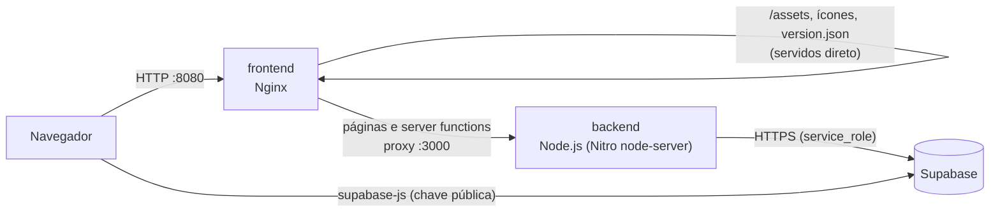

# Implantação com Docker

Este documento descreve como o SETEC Administrativo é empacotado em contêineres,
como as imagens são construídas e publicadas, e como fazer e verificar um deploy.

## Sumário

- [Visão geral](#visão-geral)
- [Arquivos](#arquivos)
- [Pré-requisitos](#pré-requisitos)
- [Variáveis de ambiente](#variáveis-de-ambiente)
- [Portas](#portas)
- [Construção das imagens](#construção-das-imagens)
- [Execução dos contêineres](#execução-dos-contêineres)
- [Implantação automatizada](#implantação-automatizada)
- [Verificação após o deploy](#verificação-após-o-deploy)
- [Identificação da versão publicada](#identificação-da-versão-publicada)
- [Pipeline no GitHub Actions](#pipeline-no-github-actions)
- [Demonstração](#demonstração)
- [Solução de problemas](#solução-de-problemas)

## Visão geral

O projeto usa TanStack Start com SSR: o mesmo servidor Node.js gera o HTML das
páginas e executa as server functions. O banco, a autenticação e o Storage ficam
no Supabase (serviço externo), por isso não há contêiner de banco.



| Serviço    | Imagem                    | Papel                                                                                                 |
| ---------- | ------------------------- | ----------------------------------------------------------------------------------------------------- |
| `backend`  | `setec-backend:<versão>`  | Servidor TanStack Start (SSR + server functions). Usuário sem privilégios, healthcheck próprio.       |
| `frontend` | `setec-frontend:<versão>` | Nginx: porta de entrada, arquivos estáticos com cache longo e gzip, cabeçalhos de segurança e versão. |

**Por que dois contêineres se o front é SSR?** O HTML depende do servidor Node,
então o front-end não é um site estático isolado. O Nginx assume o que não
precisa de Node (arquivos do build, compressão, cache, cabeçalhos) e só repassa
ao back-end o que realmente precisa ser renderizado. Os estáticos são copiados
da imagem do back-end no build, então os dois contêineres são sempre da mesma
versão.

**Dependências entre serviços:** o `frontend` só sobe depois que o `backend`
fica `healthy` (`depends_on: condition: service_healthy`). Os dois ficam na
rede interna `interna`; só a porta do Nginx é publicada no host.

**Build para Node sem afetar a Lovable:** por padrão o Nitro gera saída para
Cloudflare Workers. No Docker, o build roda com `NITRO_PRESET=node-server`,
que tem prioridade sobre o padrão. O `vite.config.ts` não foi alterado, então o
deploy pela Lovable/Cloudflare continua igual.

## Arquivos

```
├── docker/
│   ├── backend/Dockerfile              # build multi-stage: deps -> build -> runtime
│   └── frontend/
│       ├── Dockerfile                  # Nginx + estáticos da imagem do backend
│       ├── nginx.conf.template         # proxy, cache, gzip, /healthz, X-App-Version
│       └── 15-lovable-assets.sh        # proxy opcional para as logos hospedadas na Lovable
├── docker-compose.yml                  # serviços, portas, variáveis, rede e dependências
├── .dockerignore                       # contexto de build enxuto e sem .env
├── scripts/docker/
│   ├── deploy.sh / deploy.ps1          # deploy automatizado com rollback
│   └── verify.sh / verify.ps1          # verificação pós-deploy
└── .github/workflows/docker.yml        # build, teste, publicação no GHCR e deploy
```

## Pré-requisitos

- Docker 24+ com Docker Compose v2.17+ (Docker Desktop no Windows/macOS).
- Um projeto Supabase configurado (ver [README](../README.md#banco-de-dados)).
- Para os scripts `.sh` no Windows: Git Bash ou WSL. Ou use as versões `.ps1`.

## Variáveis de ambiente

Tudo fica no `.env` na raiz (copie de `.env.example`). O Compose lê esse arquivo
automaticamente. O `.env` nunca entra na imagem (está no `.dockerignore`).

| Variável                        | Onde é usada                 | Quando       | Obrigatória |
| ------------------------------- | ---------------------------- | ------------ | ----------- |
| `VITE_SUPABASE_URL`             | bundle do navegador          | build        | sim         |
| `VITE_SUPABASE_PUBLISHABLE_KEY` | bundle do navegador          | build        | sim         |
| `VITE_SUPABASE_PROJECT_ID`      | bundle do navegador          | build        | não         |
| `SUPABASE_URL`                  | backend (server functions)   | execução     | sim         |
| `SUPABASE_PUBLISHABLE_KEY`      | backend                      | execução     | sim         |
| `SUPABASE_SERVICE_ROLE_KEY`     | backend (só no servidor)     | execução     | sim         |
| `LOVABLE_CRON_SECRET`           | backend (rotas de cron)      | execução     | não         |
| `HTTP_PORT`                     | porta do host para o Nginx   | execução     | não (8080)  |
| `IMAGE_PREFIX`                  | nome das imagens             | build/deploy | não (setec) |
| `LOVABLE_ASSETS_ORIGIN`         | frontend: proxy de `/__l5e/` | execução     | não         |
| `APP_VERSION`                   | tag das imagens e versão     | build/deploy | automática  |
| `GIT_COMMIT`, `BUILD_DATE`      | metadados da versão          | build        | automáticas |

As `VITE_*` são embutidas no JavaScript do navegador durante o build (por isso
são _build args_). Só coloque nelas valores públicos. A `SUPABASE_SERVICE_ROLE_KEY`
é passada apenas ao contêiner `backend`, em tempo de execução.

> **Logos:** as imagens de logo do projeto estão hospedadas na Lovable (caminho
> `/__l5e/...`) e não existem no repositório. Para exibi-las no contêiner,
> defina `LOVABLE_ASSETS_ORIGIN` com a URL publicada do projeto na Lovable.

## Portas

| Contêiner  | Porta interna | Porta no host        | Observação                                      |
| ---------- | ------------- | -------------------- | ----------------------------------------------- |
| `frontend` | 80            | `${HTTP_PORT:-8080}` | único ponto de entrada                          |
| `backend`  | 3000          | não publicada        | acessível só pela rede interna (`backend:3000`) |

Para expor o backend no host durante testes, descomente o bloco `ports` do
serviço `backend` no `docker-compose.yml`.

## Construção das imagens

Com Compose (recomendado):

```bash
cp .env.example .env        # e preencha
docker compose build
```

Manualmente, imagem por imagem:

```bash
# back-end
docker build -f docker/backend/Dockerfile -t setec-backend:1.0.0 \
  --build-arg APP_VERSION=1.0.0 \
  --build-arg GIT_COMMIT=$(git rev-parse --short HEAD) \
  --build-arg VITE_SUPABASE_URL=https://xxxx.supabase.co \
  --build-arg VITE_SUPABASE_PUBLISHABLE_KEY=chave-publica .

# front-end (usa os estáticos da imagem do back-end)
docker build -f docker/frontend/Dockerfile -t setec-frontend:1.0.0 \
  --build-arg APP_VERSION=1.0.0 \
  --build-context backend=docker-image://setec-backend:1.0.0 .
```

Etapas do `docker/backend/Dockerfile`:

1. **deps**: instala o pnpm e as dependências com `--frozen-lockfile` (camada em cache enquanto o lockfile não mudar).
2. **build**: grava `public/version.json` e roda `pnpm run build` com `NITRO_PRESET=node-server`.
3. **runtime**: imagem `node:24-alpine` só com a pasta `.output` (o Nitro já empacota as dependências usadas), usuário `node`, `HEALTHCHECK` e labels OCI com versão e commit.

## Execução dos contêineres

```bash
docker compose up -d          # sobe em segundo plano
docker compose ps             # estado e saúde
docker compose logs -f        # logs
docker compose down           # para e remove
```

Atalhos no `package.json`: `pnpm docker:build`, `pnpm docker:up`,
`pnpm docker:down`, `pnpm docker:logs`, `pnpm docker:deploy`, `pnpm docker:verify`.

Sem Compose:

```bash
docker network create setec
docker run -d --name backend --network setec --env-file .env setec-backend:1.0.0
docker run -d --name frontend --network setec -p 8080:80 \
  -e BACKEND_HOST=backend:3000 setec-frontend:1.0.0
```

## Implantação automatizada

```bash
scripts/docker/deploy.sh            # Linux, macOS, Git Bash
# ou
powershell -ExecutionPolicy Bypass -File scripts/docker/deploy.ps1
```

O script:

1. Define a versão: tag do git (`v1.2.0` → `1.2.0`) ou `versão-do-package.json-commit` (ex.: `1.0.0-1b0c169`). Com alterações não commitadas, adiciona `-dirty`. Também aceita a versão como argumento.
2. Constrói `setec-backend:<versão>` e `setec-frontend:<versão>`.
3. Sobe os contêineres (`docker compose up -d`).
4. Roda a verificação pós-deploy.
5. Se passar, grava a versão em `.deploy/current-version` e no histórico `.deploy/history.log`. Se falhar, mostra os logs e volta para a versão anterior (as imagens antigas continuam no Docker com a tag delas).

Em um servidor, a pasta precisa ter o repositório (ou só `docker-compose.yml`,
`scripts/docker/` e `.env`). Com imagens publicadas no GHCR, basta:

```bash
export IMAGE_PREFIX=ghcr.io/mkrosz/setec-administrativo APP_VERSION=1.0.0-1b0c169
docker compose pull && docker compose up -d --no-build
scripts/docker/verify.sh "$APP_VERSION"
```

## Verificação após o deploy

`scripts/docker/verify.sh [versão] [url]` (ou `verify.ps1 -Expected <versão>`) confere:

| Checagem                      | Como                                                         |
| ----------------------------- | ------------------------------------------------------------ |
| Saúde dos contêineres         | `HEALTHCHECK` de `backend` e `frontend` = `healthy`          |
| Nginx no ar                   | `GET /healthz` → 200                                         |
| Versão correta                | `GET /version.json` igual à versão esperada                  |
| Páginas SSR                   | `GET /` e `GET /checkin/...` → 200 (renderizadas no backend) |
| Estáticos servidos pelo Nginx | primeiro `/assets/*.js` do HTML → 200 com `Cache-Control`    |

Exemplo de saída:

```
==> Verificando http://localhost:8080 (versão esperada: 1.0.0-1b0c169)
  [ok]    contêiner backend healthy
  [ok]    contêiner frontend healthy
  [ok]    /healthz -> 200
  [ok]    versão publicada: 1.0.0-1b0c169 (cabeçalho X-App-Version: 1.0.0-1b0c169)
  [ok]    / -> 200
  [ok]    /checkin/verificacao-deploy -> 200
  [ok]    /assets/index-BA8_Uoxs.js -> 200 (cache-control: public, max-age=31536000, immutable)
==> Verificação: tudo certo
```

O script sai com código diferente de zero quando algo falha, o que permite usá-lo
no CI e no rollback.

## Identificação da versão publicada

A versão fica visível em quatro lugares:

- `GET /version.json` → `{"name":"setec-administrativo","version":"1.0.0-1b0c169","commit":"1b0c169","buildDate":"..."}`
- Cabeçalho HTTP `X-App-Version` em todas as respostas do Nginx.
- Tag das imagens (`setec-backend:1.0.0-1b0c169`) e labels OCI:
  `docker inspect setec-backend:1.0.0-1b0c169 --format '{{json .Config.Labels}}'`
- Variáveis `APP_VERSION` e `GIT_COMMIT` dentro dos contêineres e o histórico em `.deploy/history.log`.

Para lançar uma versão "oficial": atualize `version` no `package.json`, faça o
merge e crie a tag `git tag v1.1.0 && git push origin v1.1.0`.

## Pipeline no GitHub Actions

O workflow [`.github/workflows/docker.yml`](../.github/workflows/docker.yml):

| Evento         | O que faz                                                                 |
| -------------- | ------------------------------------------------------------------------- |
| Pull Request   | constrói as imagens, sobe os contêineres e roda `verify.sh` (não publica) |
| Push na `main` | idem + publica `ghcr.io/mkrosz/setec-administrativo-{backend,frontend}`   |
| Tag `v*`       | idem, com a versão da tag                                                 |
| Após publicar  | job `deploy` via SSH, se a variável `DEPLOY_ENABLED` for `true`           |

Configuração (Settings → Secrets and variables → Actions):

- **Secrets opcionais do build:** `VITE_SUPABASE_URL`, `VITE_SUPABASE_PUBLISHABLE_KEY`, `SUPABASE_SERVICE_ROLE_KEY`. Sem eles, o teste usa valores fictícios (o SSR funciona, só o acesso ao Supabase não).
- **Deploy:** variável `DEPLOY_ENABLED=true` e secrets `DEPLOY_HOST`, `DEPLOY_USER`, `DEPLOY_SSH_KEY`, `DEPLOY_PATH`. O job usa o environment `producao`, onde dá para exigir aprovação manual.

> Atenção: as imagens publicadas no GHCR carregam a URL e a chave **pública** do
> Supabase usadas no build. Nunca coloque a `service_role` em `VITE_*`.

## Demonstração

Roteiro para apresentar a aplicação containerizada:

1. `cp .env.example .env` e preencher as chaves.
2. `scripts/docker/deploy.sh` (ou `deploy.ps1`) e acompanhar build, subida e verificação.
3. `docker compose ps` mostrando os dois serviços `healthy` e só a porta 8080 publicada.
4. Abrir `http://localhost:8080`, fazer login e navegar no painel.
5. Abrir `http://localhost:8080/version.json` e mostrar a versão e o commit.
6. `curl -I http://localhost:8080/` mostrando o cabeçalho `X-App-Version`.
7. Fazer um commit qualquer, rodar o deploy de novo e mostrar a versão nova em `/version.json` e no `.deploy/history.log`.
8. (Opcional) Mostrar a aba Actions com o workflow **Docker** verde e as imagens em Packages.

## Solução de problemas

| Problema                                           | Causa provável / solução                                                                       |
| -------------------------------------------------- | ---------------------------------------------------------------------------------------------- |
| `defina VITE_SUPABASE_URL no .env`                 | `.env` ausente ou incompleto.                                                                  |
| `additional_contexts` não reconhecido              | Docker Compose antigo; atualize para 2.17+.                                                    |
| `frontend` não sobe, `backend` unhealthy           | `docker compose logs backend`; geralmente variável do servidor faltando.                       |
| Porta 8080 ocupada                                 | Mude `HTTP_PORT` no `.env`.                                                                    |
| Logos não aparecem                                 | Defina `LOVABLE_ASSETS_ORIGIN` (ver [variáveis](#variáveis-de-ambiente)).                      |
| `bash\r: No such file` no Windows                  | Arquivo com CRLF. O `.gitattributes` força LF; rode `git add --renormalize .` se clonou antes. |
| Login funciona no `pnpm dev`, mas não no contêiner | Confira se as `VITE_*` estavam no `.env` **no momento do build** e reconstrua.                 |
